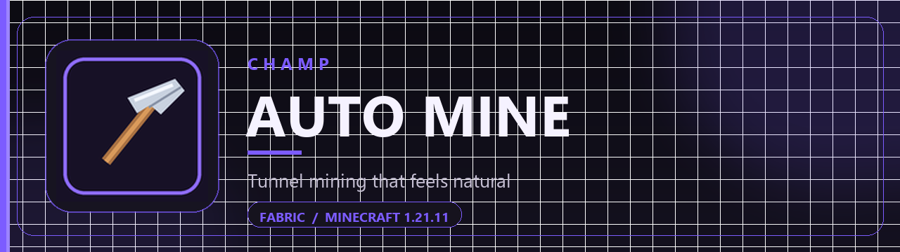
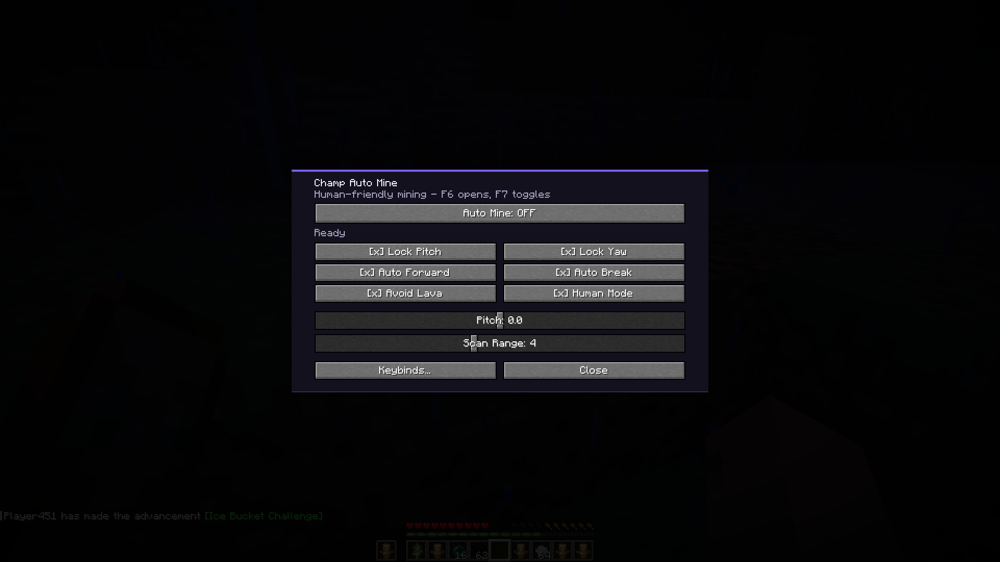

# Champ Auto Mine

A compact **client-side tunnel miner** for **Minecraft 1.21.11** on **Fabric**, with a native Minecraft GUI.

Champ Auto Mine is a small automation mod for digging a straight tunnel. It locks your yaw, holds a configurable pitch, keeps forward and attack pressed, and mines the block directly ahead. If lava or fire is detected in front, it briefly strafes to the safer side. There is no ImGui: the interface uses normal Minecraft buttons and sliders.

Everything runs on the client. The mod has no API-key code, no accounts, no analytics, no telemetry and no network requests.

## Features

- Straight one-block-wide tunnel mining.
- Yaw lock and configurable pitch lock.
- Holds forward and attack for you.
- Lava and fire detection up to 8 blocks ahead.
- Automatic short strafe to the safer side.
- Optional Mod Menu 17.0.1 integration with a config button in the mod list.
- Built-in keybind editor with rebind and reset.
- Human Mode with light view sway and occasional short pauses.
- Compact native Minecraft GUI for GUI scale 2.
- Settings saved in `config/champ-auto-mine.json`.
- Fabric and Java 21, client side only.
- Source code and a sources jar are included.

## How to use

1. Install Fabric Loader for Minecraft 1.21.11 and Fabric API.
2. Put `champ-auto-mine-1.1.0.jar` in your `mods` folder.
3. Optional: add Mod Menu 17.0.1 or newer to open the settings from the mod list.
4. Join a world and face the direction you want to tunnel.
4. Hold the correct pickaxe in your main hand.
5. Press `F6` to open the panel.
6. Press `Auto Mine: OFF` or press `F7` to start.
7. Press `F7` again to stop.

Closing the panel with `Escape` does not stop the miner. Change the keybinds under `Keybinds...` in the panel, or in Minecraft's Controls screen. `Reset keys` restores F6 and F7.

Human Mode is on by default. It adds small view sway and short pauses for a more natural camera; turn it off for the old rigid lock.

## Options

| Option | Default | Description |
| --- | --- | --- |
| Lock pitch | On | Holds the configured pitch while mining. |
| Pitch | 0.0 | The pitch to hold. 0 looks straight ahead. |
| Lock yaw | On | Keeps the direction from when mining started. |
| Auto forward | On | Holds the forward key. |
| Auto break | On | Holds attack and mines ahead. |
| Avoid lava | On | Scans for lava and fire and strafes away. |
| Human Mode | On | Adds small view sway and occasional short pauses. |
| Scan range | 4 | Hazard scan distance from 1 to 8 blocks. |

## Compatibility

| | |
| --- | --- |
| Minecraft | 1.21.11 |
| Loader | Fabric Loader 0.19.0+ |
| Dependency | Fabric API |
| Optional | Mod Menu 17.0.1+ |
| Java | 21 |
| Environment | Client |
| License | MIT |

## Important notes

- Use this only on servers where automation and client mods are allowed. Many servers prohibit macros or automation.
- The miner only mines the block directly ahead; it is not a full quarry.
- It does not switch tools, place torches, collect drops or fight mobs.
- Hazard avoidance is a short reactive strafe, not full pathfinding. Lava can still be dangerous.
- The server remains in control. The mod does not bypass anti-cheat, permissions or reach limits.

## Privacy and security

The mod contains no API-key handling, no tokens, no analytics and no outbound HTTP or WebSocket code. It writes only its local config file. The public GitHub repository has no collaborators and is read-only for visitors.

## License

MIT. See the repository's `LICENSE` file.
