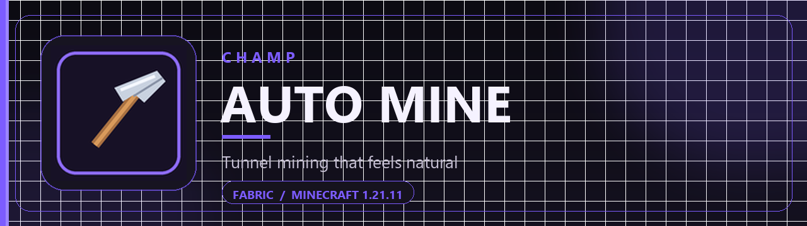
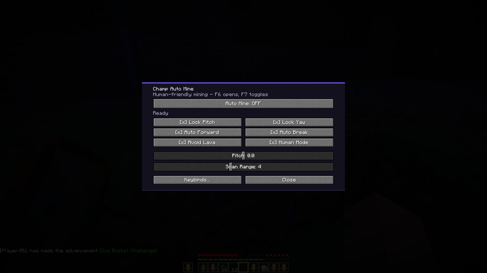
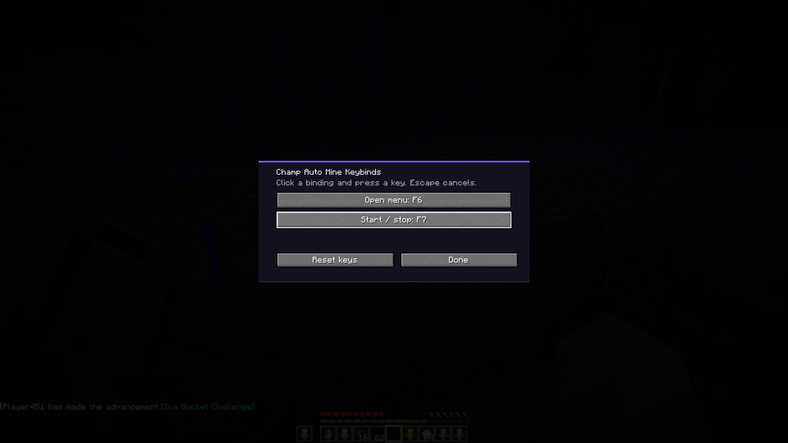

# Champ Auto Mine



A compact client-side tunnel miner for **Minecraft 1.21.11** on **Fabric**, with a native Minecraft GUI.



Champ Auto Mine keeps forward and attack held while you face a direction. It locks your yaw, holds a configurable pitch, mines the block directly ahead and strafes away when lava or fire is detected in front. Everything runs locally in the client; there is no ImGui, no API key handling, no telemetry and no network code.

## Features

- Straight, one-block-wide tunnel mining.
- Locks yaw to the direction you were facing when mining started.
- Holds a configurable pitch so the tunnel stays level.
- Holds forward and attack; releases both when stopped.
- Lava and fire detection up to 8 blocks ahead and to the sides.
- Short automatic strafe to the safer side when a hazard is found.
- Optional Mod Menu 17.0.1 integration; open the settings from the mod list.
- Built-in keybind editor with rebind and reset.
- Human Mode with light view sway and occasional short pauses.
- Native Minecraft buttons and sliders, designed for GUI scale 2.
- Settings persist in `config/champ-auto-mine.json`.
- Small, clean codebase with a sources jar for every release.

## Requirements

| Requirement | Version |
| --- | --- |
| Minecraft | 1.21.11 |
| Fabric Loader | 0.19.0 or newer |
| Fabric API | 0.141.6+1.21.11 or newer for 1.21.11 |
| Java | 21 |
| Side | Client |

## Installation

1. Install Fabric Loader for Minecraft 1.21.11.
2. Put Fabric API in your `mods` folder.
3. Put `champ-auto-mine-1.1.0.jar` in the same `mods` folder.
4. Optional: install Mod Menu 17.0.1 or newer to open the settings from the mod list.
5. Start the game with the Fabric profile.

The sources jar is for reading and building, not for the `mods` folder.

## Controls

| Key | Action |
| --- | --- |
| `F6` | Open the Auto Mine panel |
| `F7` | Start or stop mining |
| `Escape` | Close the panel without stopping the miner |

Change the keys in the panel under `Keybinds...`, or in Minecraft's normal Controls screen under the Champ Auto Mine category. `Reset keys` restores the F6 and F7 defaults. If either key is already used by another mod, rebind it in the panel.



## Usage

1. Join a world and face the direction you want to tunnel.
2. Hold the correct pickaxe in your main hand.
3. Press `F6` and set the pitch and scan range.
4. Press `Auto Mine: OFF` or press `F7` to start.
5. Press `F7` again to stop. Closing the screen with `Escape` leaves the miner running.

Human Mode is on by default. It adds a small amount of view sway and short pauses so the tunnel does not look perfectly robotic. Turn it off if you want the old rigid camera lock.

The miner does not switch tools, place torches, collect drops, eat food or fight mobs. Keep the right tool selected and watch your surroundings.

## Options

| Option | Default | Description |
| --- | --- | --- |
| Lock pitch | On | Keeps the pitch at the configured value while mining. |
| Pitch | 0.0 | The pitch held while mining. 0 looks straight ahead. |
| Lock yaw | On | Keeps the yaw from when mining started. |
| Auto forward | On | Holds the forward key. |
| Auto break | On | Holds attack and mines the block ahead. |
| Avoid lava | On | Scans for lava and fire and strafes to the safer side. |
| Human Mode | On | Adds small view sway and occasional short pauses for a more natural camera. |
| Scan range | 4 | Hazard scan distance, from 1 to 8 blocks. |

The panel is deliberately compact. At GUI scale 2 it fits a 427 x 240 logical screen. The sliders show their current value in the label.

## Configuration file

The mod writes:

```
.minecraft/config/champ-auto-mine.json
```

The file is plain JSON and is only read or written on your own computer. Deleting it restores the defaults.

## Important limits

- This is a client-side automation mod. Many servers prohibit automation, macros or client mods; use it only where the server rules allow it.
- The miner only mines the block directly ahead. It is not a full 3x3 quarry.
- It does not select the correct tool for you. Mining with the wrong item is slow or impossible.
- Hazard avoidance is a short reactive strafe, not full pathfinding. Lava behind a wall or below the tunnel can still be dangerous.
- The mod does not bypass anti-cheat, server permissions or reach limits. The server remains in control of what actually happens.

## Building from source

You need JDK 21. The Gradle wrapper is included.

```bash
./gradlew build
```

On Windows:

```bat
gradlew.bat build
```

The mod jar and sources jar are written to `build/libs/`:

```
champ-auto-mine-1.1.0.jar
champ-auto-mine-1.1.0-sources.jar
```

To run a development client:

```bash
./gradlew runClient
```

## Security and privacy

Champ Auto Mine contains no API-key code, no tokens, no analytics and no outbound HTTP or WebSocket requests. The only file it writes is the local config file above. See [SECURITY.md](SECURITY.md).

The GitHub repository is public and has no collaborators, so visitors have read-only access to the upstream repository. Account security controls who can push. Forks are independent copies.

## License

MIT. See [LICENSE](LICENSE).

## Disclaimer

This project is not affiliated with Mojang, Microsoft, Fabric or any server. Minecraft is a trademark of Microsoft. Use the mod at your own risk and follow the rules of any server you join.
